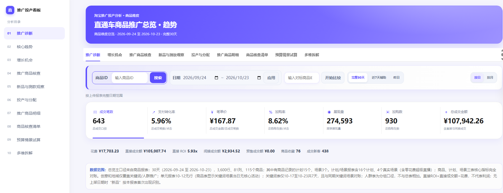
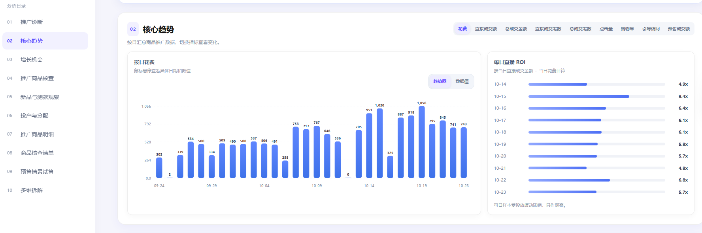
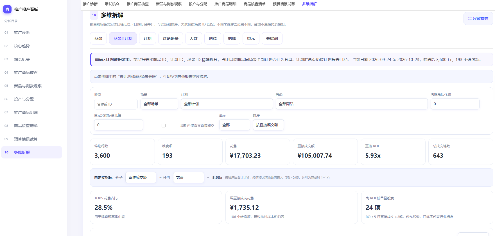

# 淘宝推广投产诊断与多维看板

  

## 实际看板截图

以上为实际 HTML 看板截图，画面含真实报告指标；原始报表文件未随仓库发布。

一个面向淘宝/天猫推广报表的本地分析 Skill。读取用户上传的 ZIP、CSV 或 XLSX 报表，做字段识别、口径校验、维度汇总和关联检查，再生成可交互的单文件 HTML 看板。

项目使用自有实现和合成样例。脚本不连接商家账号、不调用平台接口、不上传用户报表。README 展示区另含维护者授权公开的真实 HTML 看板截图，画面包含报告指标；原始报表文件未随仓库发布。生成的 HTML 会内嵌本次报告数据，应按原始报表同等保管。

## 能力范围

- 支持商品、计划、营销场景、人群、创意、地域、单元、关键词等报表类型。
- 支持 ZIP 内 CSV/XLSX、单独 CSV，以及安装依赖后读取 XLSX。
- 支持按日期及可用维度过滤；表格列可排序；提供带固定表头的悬浮查看。
- 展示花费、展现、点击、直接/总成交金额与笔数等源指标，并按实际分母计算 CTR、CPC、转化率和 ROI。
- 未识别的数值列可自选显示，并标注简单均值或合计口径。
- 根据报表中真实存在的 ID 建立关联；缺少商品 ID 的维度不推断到具体商品。
- 输出字段覆盖、日期覆盖、重复文件和不可计算指标提示。
- 报告按“推广诊断、核心趋势、增长机会、商品核查、新品观察、投产分配、商品明细、核查清单、预算试算、多维拆解”组织，并提供数据质量与口径页。
- 商品层分析基于商品主表；同一商品跨计划比较要求商品 ID、计划 ID 同时存在，有场景 ID 时按同场景对比。
- 支持以最低样本门槛筛选高 ROI 观察项、零成交花费核查、首次出现在报表的日期观察、商品花费集中度和预算敏感性试算。
- 诊断结果是规则命中的复核线索，不自动给出停投或加预算指令；新品页的“首次出现”不等于真实上架日期，预算试算不构成预测。

## 本地使用

创建 Python 虚拟环境，安装 requirements.txt，然后运行：

    python scripts/build_report.py --input ./my-reports --output ./output/promotion-report.html

input 可指向含多个报表的目录、单个 ZIP/CSV/XLSX。源文件只在本机读取；脚本不会把源报表复制进项目目录。

## Skill 使用

Codex 安装、依赖配置和手动运行步骤见 [安装指南](docs/installation.md)。其他 Agent Skills 宿主需要具备本地文件读取和 Python 命令执行能力。

完整输入要求、字段口径和关联边界见 SKILL.md、docs/data-contract.md 与 docs/metric-logic.md。

开源前复核记录见 [docs/pre-release-audit.md](docs/pre-release-audit.md)。

## 当前状态

当前项目代码版本为 0.2.0，尚未创建对应 GitHub Release 或版本标签。仓库采用 MIT 许可证，包含源代码、文档、合成样例和项目插画。Windows + Python 3.12 的自动化用例和合成报表已验证；干净 Codex 配置中的 Skill 自动发现与调用，以及 Python 3.10/3.11 和 macOS/Linux 尚未验证。
